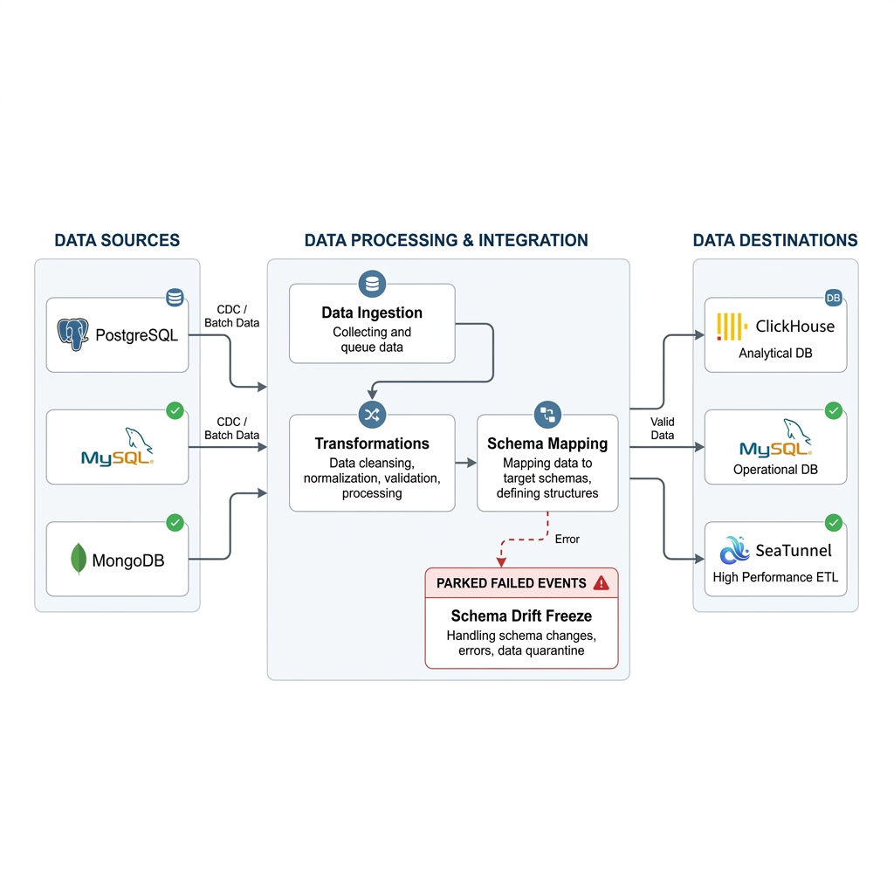

# Schema Evolution Engine

[English](README.md) | **Tiếng Việt**

> Lớp quản lý schema đặt cạnh pipeline CDC có sẵn: tự đồng bộ thay đổi an toàn, chặn thay đổi nguy hiểm, và **không làm mất dòng dữ liệu nào**.



[](https://www.python.org/)
[](https://fastapi.tiangolo.com/)
[](https://react.dev/)
[](https://debezium.io/)
[](https://redpanda.com/)
[](https://clickhouse.com/)

## Mục lục

1. [Dự án giải quyết vấn đề gì](#1-dự-án-giải-quyết-vấn-đề-gì)
2. [Kiến trúc](#2-kiến-trúc)
3. [Tính năng](#3-tính-năng)
4. [Cơ sở dữ liệu được hỗ trợ](#4-cơ-sở-dữ-liệu-được-hỗ-trợ)
5. [Cài đặt và chạy demo](#5-cài-đặt-và-chạy-demo)
6. [Các kịch bản demo](#6-các-kịch-bản-demo)
7. [Khai báo pipeline](#7-khai-báo-pipeline)
8. [Tích hợp với data plane](#8-tích-hợp-với-data-plane)
9. [Kết quả đo](#9-kết-quả-đo)
10. [Kiểm thử](#10-kiểm-thử)
11. [Cấu trúc thư mục](#11-cấu-trúc-thư-mục)
12. [Hạn chế đã biết](#12-hạn-chế-đã-biết)

---

## 1. Dự án giải quyết vấn đề gì

Trong một pipeline CDC (Postgres → Debezium → Kafka → loader → kho dữ liệu), dev ở phía nguồn có thể đổi schema bất cứ lúc nào. Khi đó, pipeline thông thường gặp một trong hai chuyện:

- **Chết ngay**: sink gặp cột lạ, bị kho dữ liệu từ chối (`Unrecognized column ...`), rồi dừng hẳn. Từ đó dữ liệu không vào kho nữa cho tới khi có người tự tay `ALTER TABLE`.
- **Hỏng âm thầm**: đổi tên cột làm vỡ dashboard, thu hẹp kiểu làm cắt cụt dữ liệu, mà không ai được báo.

Schema Evolution Engine theo dõi schema nguồn, so với một **baseline** đã lưu, rồi quyết định:

| Loại thay đổi | Ví dụ | Engine làm gì |
|---|---|---|
| **Không breaking** | Thêm cột, nới rộng kiểu (`NUMERIC(18,8)` → `NUMERIC(24,8)`) | Tự `ALTER` bảng đích trong khoảng 1 giây. Luồng dữ liệu không dừng. |
| **Breaking** | Đổi tên cột, xoá cột, thu hẹp kiểu, đổi kiểu không tương thích | **Freeze** đúng bảng đó, giữ dữ liệu chờ trong Kafka, gửi cảnh báo Telegram, chờ người duyệt (có chạy thử trên bản sao trước). |
| **Nguồn tự quay về baseline** | Dev hoàn tác thay đổi nguy hiểm | Tự gỡ freeze, luồng dữ liệu chạy tiếp. |

Ba nguyên tắc thiết kế:

1. **Engine không chép dữ liệu.** Nó chỉ quản lý schema (control plane). Dữ liệu vẫn đi qua luồng có sẵn của bạn (data plane).
2. **Hai bên nói chuyện qua API.** Loader hỏi **Gate API** "bảng đang open hay frozen", và báo trạng thái qua **Reporting API**. Với sink không sửa được code (Kafka Connect), engine tự pause và resume connector.
3. **Freeze không làm mất dữ liệu.** Khi bảng bị freeze, loader dừng ghi và không commit offset, nên dữ liệu nằm chờ trong Kafka. Khi bảng được mở lại, loader ghi tiếp từ đúng chỗ đã dừng.

---

## 2. Kiến trúc

```
                    DATA PLANE (luồng dữ liệu có sẵn của bạn)
 Postgres / MySQL / MongoDB ─► Debezium ─► Kafka (Redpanda) ─┬─► loader của bạn ─────► ClickHouse / MySQL / Postgres
                                                             └─► Kafka Connect sink ─► (bảng đích)
                                   │                               ▲          ▲
             message CDC mang theo │ cấu trúc bảng                 │ Gate API │ pause / resume
                                   ▼                               │          │
 ┌─────────────────────────── CONTROL PLANE: Schema Evolution Engine ──────────────────────────┐
 │ Kafka consumer ─► worker của từng pipeline ─► đọc schema nguồn ─► so với baseline (registry)│
 │   • không breaking → ALTER đích        • breaking → freeze, lưu bản nháp, báo Telegram      │
 │ FastAPI: Gate API · Reporting API · duyệt / từ chối · sandbox · cấu hình  ─►  Web UI (React)│
 └─────────────────────────────────────────────────────────────────────────────────────────────┘
```

- **Phát hiện theo sự kiện.** Engine đọc message Debezium và chỉ đọc lại schema nguồn khi *cấu trúc* message đổi (fingerprint khác). Ngoài ra còn có một lần quét định kỳ để dự phòng, phòng khi bỏ lỡ sự kiện.
- **Registry** (`data/registry/`) lưu baseline, lịch sử phiên bản schema, bản nháp chờ duyệt và trạng thái freeze của từng bảng.
- **Mỗi pipeline có worker, registry và trạng thái freeze riêng**, nên pipeline này lỗi không kéo pipeline kia theo, kể cả khi chúng dùng chung một topic Kafka.

---

## 3. Tính năng

**Engine**
- Phân loại tự động: thêm cột, nới kiểu, `NOT NULL → NULL` là không breaking; đổi tên (tự suy luận cặp cột cũ/mới), xoá cột, thu hẹp kiểu, đổi kiểu không tương thích là breaking.
- Đồng bộ đích **không mất mát**: `NUMERIC` → `Decimal` (không dùng `Float64` vốn làm tròn tiền), `TIMESTAMP` → `DateTime64(6)`, `DATE` → `Date32`.
- **Sandbox trước khi duyệt**: Postgres chạy DDL trong transaction rồi `ROLLBACK`; MySQL và ClickHouse clone bảng, chép mẫu dữ liệu thật rồi chạy DDL trên bản sao.
- **Duyệt và từ chối** trên Web UI hoặc CLI (`python -m app.unfreeze_cli list | view | approve | reject <pipeline/bảng>`). Lịch sử ghi lại ai đã duyệt.
- **Đổi tên an toàn cho message cũ**: khi duyệt `RENAME`, engine lưu ánh xạ `cũ → mới` trước khi mở bảng. Loader đọc ánh xạ qua Gate API để ghi message cũ vào cột mới.
- **Nguồn MongoDB (không có schema)**: engine suy schema từ 10.000 document mới nhất. Field vắng mặt không bị coi là đã xoá, nên không sinh freeze giả.
- **Nhiều pipeline song song**, cách ly hoàn toàn với nhau.

**Vận hành**
- **Config-as-code**: mỗi pipeline là một file `config/pipelines/*.yaml`. Sửa trên Web UI hay sửa file đều được; engine tự nạp lại trong khoảng 3 giây, không cần restart. File lỗi chỉ làm tắt pipeline đó, kèm thông báo lỗi rõ ràng.
- **Bí mật tách riêng**: YAML chỉ ghi `${TÊN}`, giá trị thật nằm trong `config/secrets.env` (đã gitignore). Mật khẩu gõ trên form được tự chuyển sang file này.
- **Cảnh báo Telegram** khi có thay đổi breaking, khi bảng được duyệt, và khi nguồn tự hoàn tác.
- **Xác thực API (tuỳ chọn)**: token cho vai trò `admin` (mọi lệnh ghi) và `reporter` (chỉ Reporting API).
- **Ba mức tích hợp**: (1) chỉ cần khai báo YAML; (2) khai báo thêm các thành phần để engine đo consumer lag và báo thành phần nào im lặng; (3) engine tự điều khiển sink Kafka Connect có sẵn.

**Web UI** (`http://localhost:5173`)
- **Pipelines Overview**: mỗi màn hình một pipeline, chuyển bằng nút `‹ ›`, mặc định là pipeline mới nhất. Hiện trạng thái gate của từng bảng, các thành phần data plane (rows/s, độ trễ, sparkline), và Live CDC Event Stream.
- **Monitored Tables**: danh sách bảng, lịch sử phiên bản, bản nháp chờ duyệt, sandbox, Approve và Reject. Trang tự cập nhật mỗi 2 giây, không cần F5.
- **Live CDC Stream**: sự kiện schema, phân trang, xoá từng sự kiện hoặc xoá hết.
- **Pipeline Topology**, **Configuration** (sửa `main.yaml` và các pipeline), **Schema Editor**. Giao diện có tiếng Việt và tiếng Anh, chế độ sáng và tối.

---

## 4. Cơ sở dữ liệu được hỗ trợ

| Vai trò | Hỗ trợ |
|---|---|
| **Nguồn** | PostgreSQL, MySQL, MongoDB |
| **Đích** | ClickHouse, PostgreSQL, MySQL, hoặc `none` (chỉ giám sát và cảnh báo, không chạy DDL) |

Nguồn và đích được phép khác loại, ví dụ MongoDB → ClickHouse hay Postgres → MySQL. Engine dùng chung một bộ tên kiểu (`int`, `bigint`, `numeric`, `text`, `timestamp`, `json`...) rồi tự chuyển sang kiểu riêng của từng hệ quản trị.

Muốn thêm một hệ quản trị khác (SQL Server, Oracle...), viết một class kế thừa `BaseEngine` trong [`src/schema_evolution/engines/`](src/schema_evolution/engines/) (có thể lấy [`mysql.py`](src/schema_evolution/engines/mysql.py) làm mẫu), rồi đăng ký nó trong `ENGINE_REGISTRY` ở [`app/scheduler.py`](app/scheduler.py).

---

## 5. Cài đặt và chạy demo

Demo là một pipeline thật: giao dịch Binance được ghi vào Postgres, Debezium đưa lên Kafka, rồi loader ghi sang ClickHouse. Cùng lúc đó chạy thêm một pipeline MongoDB và một sink Kafka Connect. Script khởi động được viết cho **Windows + PowerShell**.

**Cần có:** Docker Desktop, Python 3.11, Node.js 18 trở lên.

```powershell
git clone https://github.com/HakoNguyen/schema_evolution.git
cd schema_evolution

python -m venv venv
.\venv\Scripts\Activate.ps1
pip install -r requirements.txt
cd frontend; npm install; cd ..

Copy-Item config\secrets.env.example config\secrets.env   # mật khẩu mặc định của stack Docker đã có sẵn
powershell -ExecutionPolicy Bypass -File demo\start.ps1 -Reset
```

Muốn nhận cảnh báo qua Telegram thì điền `TELEGRAM_BOT_TOKEN` và `TELEGRAM_CHAT_ID` trong `config/secrets.env`. Để trống thì engine bỏ qua bước gửi cảnh báo.

`start.ps1 -Reset` làm theo thứ tự:
1. Bật Postgres, MongoDB, ClickHouse, Redpanda và Debezium.
2. Dựng lại toàn bộ dữ liệu demo ở schema v1, cùng 3 connector (Postgres, MongoDB, JDBC sink).
3. Mở mỗi tiến trình trong một cửa sổ riêng: `backend`, `frontend`, `ingestor`, `loader`, `naive-loader`, `tickers-loader`, `orders-app`, `orders-loader`, `check`.

Sau khoảng **1 phút**, mở **http://localhost:5173**. Nên dùng `localhost`, không dùng `127.0.0.1`.

| Dịch vụ | Địa chỉ trên máy |
|---|---|
| Web UI (Vite) | http://localhost:5173 |
| Engine API (FastAPI) | http://127.0.0.1:8000 |
| Postgres (nguồn) | `localhost:5431`: `admin` / `password123` |
| MongoDB (replica set `rs0`) | `localhost:27018`, kết nối với `directConnection=true` |
| ClickHouse | `localhost:8123`: `default` / `clickhouse123` |
| Kafka (Redpanda) | `localhost:19092`, giao diện Redpanda Console ở http://localhost:8086 |
| Kafka Connect (Debezium) | http://localhost:8083 |

**Chạy bằng một Docker image.** Engine, API và Web UI nằm chung một image, dùng chung một cổng:

```powershell
docker compose up -d --build engine     # mở http://localhost:8000
docker compose stop engine
```

Image này dùng cùng `config/` và `data/` với máy host, và **không được** chạy cùng lúc với `uvicorn` trên máy, vì cả hai đều chiếm cổng 8000.

---

## 6. Các kịch bản demo

Mỗi lệnh dưới đây đóng vai dev đổi schema ở nguồn, rồi đo thời gian engine phản ứng. Chạy trong PowerShell, sau khi đã `.\venv\Scripts\Activate.ps1`.

**Pipeline `market_trades` (Postgres → ClickHouse)**

| Lệnh `python -m demo.scenario ...` | SQL chạy trên nguồn | Kết quả mong đợi |
|---|---|---|
| `add_column` | `ALTER TABLE trades ADD COLUMN is_buyer_maker BOOLEAN` | ClickHouse tự có cột mới. `loader` chạy tiếp, còn `naive-loader` (đối chứng, không có engine) chết với lỗi `Unrecognized column` |
| `widen` | `ALTER TABLE trades ALTER COLUMN price TYPE NUMERIC(24,8)` | `price` ở ClickHouse tự thành `Decimal(24, 8)` |
| `rename` | `ALTER TABLE trades RENAME COLUMN qty TO quantity` | Bảng bị freeze, loader `paused`. Duyệt trên UI (Sandbox rồi Approve) thì loader ghi tiếp, kể cả các message cũ còn mang tên `qty` |
| `narrow` | `ALTER TABLE trades ALTER COLUMN symbol TYPE VARCHAR(10)` | Bảng bị freeze (nguy cơ cắt cụt dữ liệu). **Không** Approve |
| `rollback` | `ALTER TABLE trades ALTER COLUMN symbol TYPE VARCHAR(20)` | Nguồn khớp lại baseline, engine tự gỡ freeze |

**Pipeline `market_tickers`**: `tickers_drop` (`DROP COLUMN low_price`) làm **chỉ** pipeline này bị freeze, còn `market_trades` vẫn chạy. `tickers_restore` thêm lại cột thì bảng tự mở lại. Nếu bật thêm pipeline `market_tickers_replica` (mức 3), engine còn tự **pause** sink Kafka Connect khi freeze và **resume** khi mở lại.

**Pipeline `shop_orders` (MongoDB → ClickHouse).** Mongo không có `ALTER`. "Đổi schema" ở đây là app ra bản mới, ghi document theo hình dạng khác:

| Lệnh | App làm gì | Kết quả mong đợi |
|---|---|---|
| `orders_add_field` | Ghi thêm field `coupon_code` | ClickHouse tự có cột `coupon_code` |
| `orders_drop_field` | Thôi ghi field `note` | **Không** freeze giả: field vắng mặt không có nghĩa là đã xoá |
| `orders_bad_type` | Ghi `amount` thành chuỗi `"12.50"` | Bảng bị freeze, loader dừng |
| `orders_fix` | Rollback app và đổi các `amount` dạng chuỗi về số | Engine tự gỡ freeze |

Kiểm chứng cuối bằng `python -m demo.check`: tính tới một mốc thời gian, nguồn và kho phải **khớp từng dòng**.

Chi tiết từng bước, cách đọc kết quả, các tình huống lỗi hay gặp: xem [`demo/README.md`](demo/README.md).

---

## 7. Khai báo pipeline

Có hai cách: thả một file YAML vào `config/pipelines/`, hoặc điền form ở trang **Configuration**. Ví dụ:

```yaml
name: market_trades
detection:
  mode: event_driven                  # hoặc polling (kèm interval_seconds)
  kafka:
    topic: market                     # tiền tố topic Debezium: khớp market.public.trades
  fallback_polling_interval_seconds: 60
source:
  type: postgres
  config: {host: localhost, port: 5431, dbname: exchange, user: admin, password: "${EXCHANGE_PG_PASSWORD}"}
target:
  type: clickhouse
  config: {host: localhost, port: 8123, database: analytics, user: default, password: "${ANALYTICS_CH_PASSWORD}"}
tables:
  - trades
```

- `kafka.topic` là **tiền tố**: `market` khớp với `market.public.trades`. Đặt sai thì engine không nhận được sự kiện, chỉ phát hiện thay đổi ở lần quét dự phòng.
- Khi tạo pipeline trên form, ô cổng nguồn mặc định là `5432`; với stack demo phải đổi thành **`5431`**.
- Tài liệu đầy đủ: [`CONFIGURATION_GUIDE.md`](CONFIGURATION_GUIDE.md). Ở đó có thêm: nhiều Kafka cluster, đặt tên bảng đích khác nguồn, cấu hình nào cần restart, khai báo `components:` và bật xác thực.

---

## 8. Tích hợp với data plane

Engine không cần biết bên trong loader của bạn. Loader chỉ cần:

```http
GET /api/gate/{pipeline}/{table}
→ {"state": "open" | "frozen", "schema_version": 4,
   "pending_changes": [{"change_type": "rename_column", "column": "qty"}],
   "column_renames": {"qty": "quantity"}}
```

- `frozen`: **dừng ghi** bảng đó và không commit offset, cho tới khi trạng thái về lại `open`.
- Message có cột mà bảng đích chưa có: **chờ** (HOLD) cho tới khi engine thêm xong cột, đừng bỏ cột đó đi.
- Không gọi được engine: giữ trạng thái đã biết gần nhất (fail-static).

Ngoài ra, nếu muốn trạng thái của loader hiện trên Overview, gửi thêm báo cáo (không bắt buộc):

```http
POST /api/pipelines/{pipeline}/components/{name}
{"state": "running", "role": "warehouse sink", "metrics": {"rows_per_sec": 512.3, "lag_seconds": 1.6}}
```

Ví dụ hoàn chỉnh: [`demo/loader.py`](demo/loader.py) (`FreezeGate`, `Reporter`). Với sink Kafka Connect không sửa được code, chỉ cần khai báo nó dưới `components:` trong YAML; engine sẽ tự pause và resume connector (xem `CONFIGURATION_GUIDE.md` mục 5).

---

## 9. Kết quả đo

Lần dượt toàn bộ demo ngày **12/11/2026** (Windows 11, Docker Desktop, dữ liệu Binance thật). Mỗi kịch bản chạy một lần; thời gian tính từ lúc thay đổi có hiệu lực ở nguồn.

| Kịch bản | Kết quả | Thời gian |
|---|---|---|
| Thêm cột (Postgres) | ClickHouse tự có cột mới; pipeline đối chứng chết | 1,08 giây |
| Nới kiểu `price` | `Decimal(18,8)` thành `Decimal(24,8)` | 0,95 giây |
| Thu hẹp kiểu (breaking) | Bảng bị freeze, loader `paused` | 0,99 giây |
| Nguồn hoàn tác | Engine tự gỡ freeze | 0,58 giây |
| Duyệt `RENAME` | Sandbox pass, bảng mở lại ở v4, loader ghi tiếp | 7,4 giây (tới khi loader chạy lại) |
| Thêm field (MongoDB) | ClickHouse tự có `coupon_code` | 0,78 giây |
| Sink Kafka Connect (mức 3) | Connector PAUSED khi freeze, RUNNING khi mở lại | khoảng 4 giây mỗi chiều |
| Đối chiếu cuối (`demo.check`) | **21.098 / 21.098 dòng khớp**; pipeline đối chứng thiếu 17.509 dòng | |
| Bảng replica (mức 3) | Giống hệt bảng nguồn (khớp mã băm md5) | |

Số đo lặp lại nhiều lần (p50, p95) do `python -m demo.bench` tạo ra, được lưu trong [`demo/results/`](demo/results/).

---

## 10. Kiểm thử

Các test không cần hạ tầng. Mỗi file test chạy trực tiếp bằng Python (repo không dùng pytest):

```powershell
Get-ChildItem tests\test_*.py | ForEach-Object { python $_.FullName }
```

`tests/test_payload_pipeline.py` là test tích hợp cũ: nó cần một pipeline tên `mongo_to_clickhouse` (không còn trong repo) và một MongoDB ở cổng 27017, nên hiện đang lỗi.

---

## 11. Cấu trúc thư mục

```
api/            FastAPI: Gate API, Reporting API, duyệt / từ chối, sandbox, cấu hình
app/            PipelineManager (nạp lại cấu hình), Kafka consumer, worker từng pipeline, thành phần (mức 2-3), CLI
src/schema_evolution/
  core.py       registry, so sánh và phân loại thay đổi, luồng kiểm tra và freeze
  engines/      Postgres, MySQL, MongoDB, ClickHouse: đọc metadata, sinh DDL, sandbox
frontend/       Web UI (React + Vite)
config/         main.yaml, pipelines/*.yaml, secrets.env.example
demo/           pipeline demo: ingestor, loader, orders_app, setup, scenario, check, bench, start.ps1
debezium/       docker-compose của Redpanda + Debezium Connect
tests/          test đơn vị và test tích hợp
Dockerfile      image chung cho engine, API và Web UI
```

---

## 12. Hạn chế đã biết

- **Phải có baseline trước khi đổi schema.** Nếu engine chưa kết nối được nguồn hoặc đích (sai cổng, sai mật khẩu) mà nguồn đã đổi schema, baseline v1 sẽ chụp luôn thay đổi đó, và engine sẽ không bao giờ phản ứng với nó nữa. Trước mỗi kịch bản, hãy kiểm tra bảng đang ở trạng thái `vN open` với N ≥ 1.
- **MongoDB:** engine không nhận ra được việc đổi tên field (chỉ thấy một field mới). Sửa lỗi kiểu dữ liệu đòi hỏi sửa cả các document đã ghi, vì engine lấy mẫu 10.000 document mới nhất.
- **ClickHouse dùng image `latest`.** Bản 26.x nén dữ liệu bằng ZSTD theo mặc định, nên driver JDBC 0.8.x của DBeaver báo `Invalid LZ4 magic byte`. Cách khắc phục: thêm thuộc tính driver `compress=false`.
- Script khởi động demo (`start.ps1`) chỉ dành cho Windows. Engine và API thì chạy được ở mọi nơi có Python, hoặc qua Docker image.

---

## Giấy phép

MIT. Xem [`LICENSE`](LICENSE).
